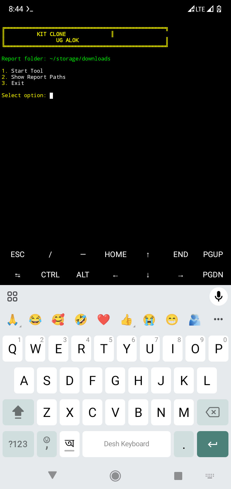

# BIG BOSS

**Developer:** UG ALOK

## Overview

This project is intended for educational purposes only.

## Project Structure

```text
Security-Project/
├── security.py
├── install.sh
├── README.md
├── DISCLAIMER.md
└── .venv/
```

## Installation

```bash
git clone https://github.com/UG-ALOK/BIG-BOSS.git
```
```bash
cd BIG-BOSS
```
```bash
chmod +x install.sh
```
```bash
bash install.sh
```

## Run

```bash
python security.py
```

If the installer creates a virtual environment:

```bash
.venv/bin/python security.py
```

## Browser Access

After starting the server, open the URL displayed in your terminal.

Example:

```text
http://127.0.0.1:5000
```

The browser may display the project's web interface, depending on the routes implemented in `security.py`.

## Example Output

```text
Security Console
----------------
Server Status: Running
Request Status: 200 OK
Client IP: XXX.XXX.XXX.XXX
Request URL: http://XXX
Browser: Detected
```

The output above is illustrative only. Actual fields depend on the application implementation and the incoming request.

## Disclaimer
**⚠️This project is for educational purposes only.
I am not responsible for any illegal activity or misuse of this project.
Use this software only on systems and networks you own or have permission to test**

## Developer

**UG ALOk**

